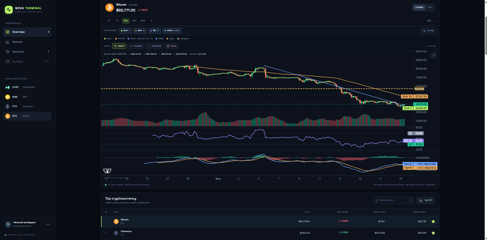
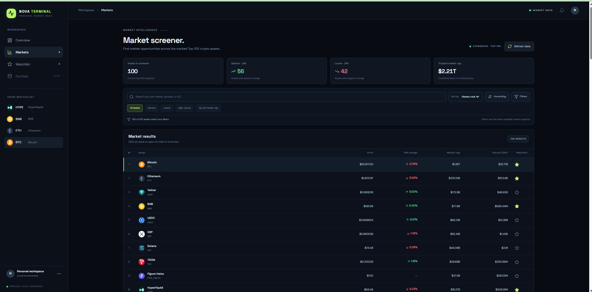

# Nova Terminal

**Personal Cryptocurrency Market & Portfolio Dashboard**  
**Release: `v1.0.0`**

Nova Terminal is a local, single-user cryptocurrency market terminal built with Django, React, TypeScript, MongoDB, and CoinGecko. It brings market monitoring, interactive charts, technical indicators, drawing tools, screening, portfolio bookkeeping, and price alerts into one desktop-friendly workspace.

> **Local-only application.** Nova Terminal has no authentication or authorization layer. Keep Django and Vite bound to `127.0.0.1`. Do not expose the development server or API to a LAN or the public internet as-is.

## Screenshots

### Technical analysis workspace



### Market screener



*Screenshots are captures from local development sessions. Market values are dynamic and will differ when you run the application.*

## Features

- **Market overview:** latest Top-100 cryptocurrency snapshot from the CoinGecko Demo REST API.
- **Watchlist:** add/remove favorite assets with MongoDB persistence.
- **Interactive charts:** candlestick and line views, selectable date ranges, crosshair OHLC details, zoom, pan, and reset.
- **Technical indicators:** EMA, SMA, RSI, and MACD with configurable periods.
- **Drawing tools:** trendlines and horizontal price levels, stored per asset in browser LocalStorage.
- **Market screener:** search, gainers/losers presets, market-cap and volume filters, and sorting.
- **Portfolio tracker:** manual BUY/SELL ledger, weighted-average cost, fees, realized/unrealized P&L, holdings, and transaction history.
- **Price alerts:** one-shot ABOVE/BELOW rules, pause/re-arm, MongoDB persistence, and optional browser notifications.
- **Quality of life:** request timeouts, loading/error/empty states, keyboard focus support, reduced-motion handling, and safe health-check responses.

## Technology stack

| Layer | Technology |
|---|---|
| Backend | Python 3.13, Django 5.2, Django MongoDB Backend 5.2 |
| API | Django REST Framework |
| Database | MongoDB Server |
| Market data | CoinGecko Demo REST API |
| Frontend | React 19, TypeScript, Vite 8 |
| Styling | Tailwind CSS 4 and application CSS |
| Charting | TradingView Lightweight Charts 5 |
| Browser storage | LocalStorage for chart drawings and indicator preferences |
| CI | GitHub Actions |

## Architecture

```text
Browser (React + TypeScript + Lightweight Charts)
  | REST requests through Vite's /api development proxy
  v
Django REST Framework
  |-- Market app ------> CoinGecko Demo REST API
  |       |              periodic refresh + chart cache
  |       v
  |    MongoDB market snapshot
  |
  |-- Watchlist app ---> MongoDB watchlist collection
  |-- Portfolio app ---> MongoDB transaction collection
  |-- Alerts app ------> MongoDB price-alert collection
  |
  v
Local MongoDB Server
```

Django owns external CoinGecko requests and database writes. The browser does not call CoinGecko directly, so the provider key remains on the backend. Technical indicators are calculated from the loaded OHLC series in the frontend.

See [ARCHITECTURE.md](ARCHITECTURE.md) for data flow and design boundaries.

## Requirements

- Python 3.13.
- Node.js 22.12+ (Node.js 26 is also suitable) and npm.
- MongoDB Server running locally, normally at `127.0.0.1:27017`.
- A CoinGecko Demo API key.
- MongoDB Compass is optional; it is a GUI client, while MongoDB Server hosts the database.

## Setup on Windows

The commands below assume you have cloned the repository and opened PowerShell in the `nova-terminal` project root.

### 1. Create and activate a Python environment

```powershell
py -3.13 -m venv .venv
.\.venv\Scripts\Activate.ps1
python -m pip install --upgrade pip
```

If PowerShell blocks activation, you can use a terminal session-scoped policy:

```powershell
Set-ExecutionPolicy -Scope Process -ExecutionPolicy Bypass
.\.venv\Scripts\Activate.ps1
```

### 2. Configure environment variables

```powershell
Copy-Item .env.example .env
```

Edit `.env` and set `COINGECKO_API_KEY`. The backend sends it in the `x-cg-demo-api-key` request header.

Keep `.env` private. Commit only `.env.example` with placeholders. The default configuration is for local development.

### 3. Install and run the backend

With the virtual environment active, from the project root:

```powershell
cd backend
python -m pip install -r requirements.txt
python manage.py check
python manage.py migrate
python manage.py runserver 127.0.0.1:8000
```

Keep this terminal running.

**Existing database note:** if you are upgrading an earlier local copy and `portfolio_portfoliotransaction` already exists while `showmigrations portfolio` marks `0001_initial` as unapplied, do not drop the collection. Confirm that it contains your existing transactions, then mark only that existing initial migration as applied:

```powershell
python manage.py migrate portfolio 0001_initial --fake
python manage.py migrate
```

Use this recovery only for the specific existing-collection mismatch. A fresh installation should use the normal `python manage.py migrate` command.

### 4. Install and run the frontend

Open a second PowerShell terminal in the project root:

```powershell
cd frontend
npm ci
npm test
npm run build
npm run dev
```

Open the local URL printed by Vite, normally `http://127.0.0.1:5173/`.

### Existing virtual environment outside the repository

If you are continuing the original development workspace where `.venv` is in the parent `Proyek` folder, activate it from the repository root with:

```powershell
..\.venv\Scripts\Activate.ps1
```

The standard fresh-clone instructions above instead create `.venv` inside the repository root. Both layouts work; keep the environment out of Git.

## Local API routes

| Method | Route | Purpose |
|---|---|---|
| GET | `/api/health/` | Check Django-to-MongoDB connectivity |
| GET | `/api/market/coins/` | Read the latest Top-100 market snapshot |
| GET | `/api/market/coins/<coin_id>/ohlc/?days=30` | Read historical OHLC and available volume observations |
| GET, POST | `/api/watchlist/` | Read/add a watchlist item |
| DELETE | `/api/watchlist/<coin_id>/` | Remove a watchlist item |
| GET | `/api/portfolio/` | Read portfolio summary, holdings, and history |
| POST | `/api/portfolio/transactions/` | Create a BUY/SELL transaction |
| PATCH, DELETE | `/api/portfolio/transactions/<id>/` | Edit/delete a transaction |
| GET, POST | `/api/alerts/` | Read/create price alerts |
| PATCH, DELETE | `/api/alerts/<id>/` | Pause/re-arm/update or delete an alert |

## Market-data behavior and limits

- The backend refreshes the Top-100 market snapshot at most once per `MARKET_REFRESH_SECONDS` (default `600` seconds).
- Chart responses use Django's process-local cache with `CHART_CACHE_SECONDS` (default `600` seconds).
- CoinGecko Demo is a periodic REST source, not a tick-by-tick streaming feed. Browser polling does not make each user interaction a separate provider request while the backend snapshot remains fresh.
- CoinGecko selects OHLC granularity based on requested date range and API plan. Timeframe controls the date range, not a guaranteed candle interval.
- The chart's volume area uses CoinGecko `total_volumes` observations. These are market-wide 24-hour volume observations, **not exchange-specific per-candle traded volume**.
- MongoDB stores the latest Top-100 market snapshot, not an indefinite historical market-data archive. Check CoinGecko's current terms and plan rights before hosting or redistributing market data publicly.

## Portfolio accounting rules

Portfolio entries are manual. No exchange, wallet, or brokerage account is connected.

- Transaction currency is USD.
- BUY fees are added to acquisition cost.
- SELL fees reduce net sale proceeds.
- Open positions use weighted-average cost.
- A SELL that exceeds available units at its chronological execution time is rejected.
- Editing/deleting a BUY is validated against subsequent SELL transactions.
- Realized P&L is recorded on sales; unrealized P&L uses the latest available local Top-100 snapshot.
- Assets outside the latest snapshot retain quantity and cost basis but may not have a current market value.

Use USD prices consistently; do not mix IDR entries into the USD ledger.

## Price-alert behavior

- Alerts are one-shot `ABOVE` or `BELOW` rules.
- Active alerts are evaluated against a fresh saved MongoDB market snapshot. A match records the observed price and trigger time, then deactivates the rule.
- Re-arming starts a new one-shot rule; it may trigger immediately if the current snapshot already meets the threshold.
- Browser notifications are optional and require explicit permission.
- Alert evaluation happens while the local app/API is being polled. It is not a 24/7 background service and does not operate while the backend is stopped.
- The CoinGecko refresh interval determines how quickly a new provider price can be observed; alert polling does not increase provider freshness.

## Tests and quality checks

Run backend checks from `backend/` with the virtual environment active:

```powershell
python manage.py check
python -m unittest discover -s apps/portfolio/tests -v
python -m unittest discover -s apps/alerts/tests -v
```

Run frontend checks from `frontend/`:

```powershell
npm ci
npm test
npm run build
```

A GitHub Actions workflow runs the backend checks and frontend tests/build on pushes and pull requests.

## GitHub release

Before publishing, follow [RELEASE_CHECKLIST.md](RELEASE_CHECKLIST.md). In particular, confirm `.env` is not tracked, review the dependency audit, choose a project license if you intend to grant reuse rights, and keep the app local-only unless authentication and deployment hardening are added.

## Scope and safety

Nova Terminal is a personal market-analysis and record-keeping project. It is not an exchange, brokerage, custody service, trading bot, or financial-advice product. Market values can be delayed or unavailable. Do not use it as the sole source for live trading decisions.
